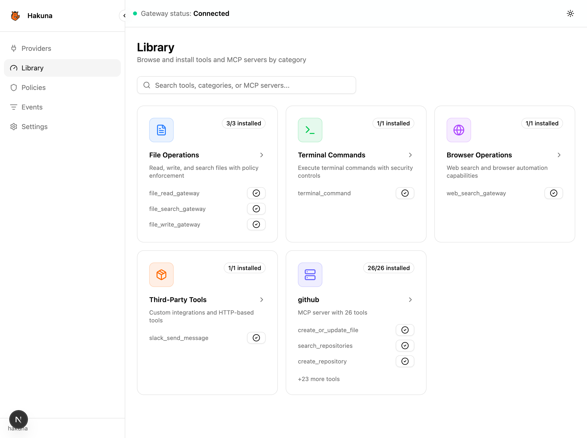
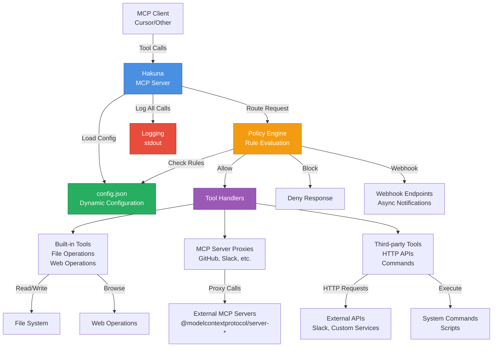

# Hakuna Gateway

[](.github/workflows/ci.yml)
[](LICENSE)

> AI tools gateway to centralize and secure Model Context Protocol (MCP) access for agents like Cursor, n8n, and custom clients.

Hakuna Gateway is a minimal MCP server that normalizes tool usage through an intent layer, applies policy controls, and routes requests to built-in or proxied tools with full auditing.

## Why Hakuna Gateway?
- **Centralize tool access** so every agent call flows through one auditable control point.
- **Intent-aware policies** to block risky actions (e.g., deleting prod resources) rather than brittle tool name checks.
- **Zero-rebuild config** via `config.json` and environment variables for quick experimentation.
- **Dashboard** to manage tools, policies, and providers visually.

## Quick start
1. **Prerequisites:** Node.js 20+, [pnpm](https://pnpm.io/), Command Line Tools/Xcode (for Mac users).
2. **Install & build (root backend):**
   ```bash
   pnpm install --frozen-lockfile
   pnpm run build
   ```
3. **Run backend & frontend together:**
   ```bash
   pnpm dev:all
   ```
   This concurrently runs `pnpm run dev:backend` (MCP server on stdio) and `pnpm run dev:frontend` (Next.js dashboard on port 1337).
4. **Run the MCP gateway only (no dashboard):**
   ```bash
   pnpm start
   ```
   You should see `Hakuna MCP Gateway server starting...` and the server will wait for MCP messages on stdio.
5. **Hello world:**
   - Copy `.env.example` to `.env`, set `JWT_SECRET`, and add any API keys you need.
   - Use the default `config.json` (built-in tools are available immediately) and connect an MCP client such as Cursor to call a file read/write tool.

## Screenshot


## Architecture


## Core concepts
- **Intent layer:** Normalizes and classifies tool calls using registry rules and optional LLM classification before policy evaluation.
- **Policy engine:** Role- and environment-aware policies that can allow, deny, log, or call webhooks.
- **Tool registry:** Built-in file/web tools plus proxies for third-party MCP servers and HTTP/command integrations.
- **Dashboard & APIs:** Manage tools, policies, providers, and audit logs through a web UI or HTTP endpoints.
- **Safe defaults:** Secrets live in environment variables; third-party connectors are disabled until credentials are supplied.

## Documentation
- [Getting Started](docs/GETTING_STARTED.md)
- [Configuration Reference](docs/CONFIGURATION.md)
- [LLM configuration for intent classification](src/intent/llm/README.md)
- [LLM providers for tool execution](src/llm/README.md)
- [Database migrations](DATABASE_MIGRATION.md) and [telemetry notes](TELEMETRY.md)

## Roadmap
- Prebuilt policy packs for common compliance scenarios.
- SSO support for the dashboard and API.
- Pluggable audit log sinks (S3, Postgres, SIEMs).
- CLI scaffolding for adding new tool proxies.
- Automated dependency and security updates.

## Who it’s for
- AI engineers and agent developers who need a consistent tool gateway.
- Security and platform teams enforcing policy-aware automation.
- Operators who want observability and approvals around high-risk tool use.

## Governance, support, and licensing
- Maintained by the [Hakuna Gateway Team](MAINTAINERS.md); issues and PRs are welcome.
- See [CONTRIBUTING](CONTRIBUTING.md) for development workflow and standards.
- Report security concerns via [SECURITY](SECURITY.md).
- Community behavior follows our [Code of Conduct](CODE_OF_CONDUCT.md).
- Licensed under the [MIT License](LICENSE).
