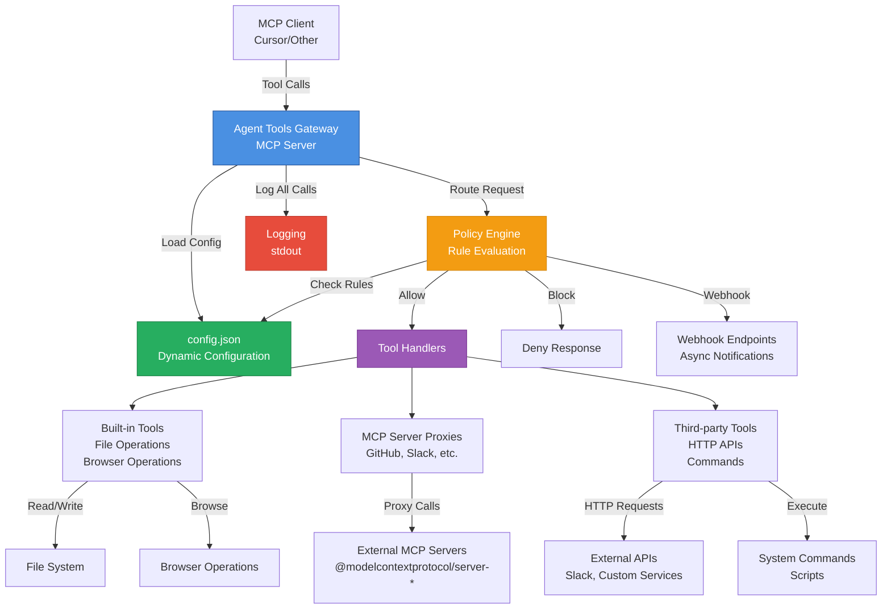

# Agent Tools MCP Gateway

This is a minimal **MCP server** that acts as a central tools gateway.

It exposes MCP tools you can plug into Cursor (or any MCP client) and:

- Route tool usage through a single gateway layer
- **Intent Layer** that normalizes and classifies tool calls using rule-based and LLM-based inference
- Apply simple per-tool / per-role policy decisions
- Log every intercepted tool call
- Policy engine with support of log/deny/webhook/custom

The gateway provides built-in tools for file operations and browser operations, plus the ability to proxy entire MCP servers and add custom third-party integrations.

## Architecture



**Flow:**
1. **MCP Client** (Cursor) sends tool calls to the **Gateway**
2. **Gateway** loads configuration from `config.json` (no rebuild needed)
3. **Intent Layer** normalizes and classifies the tool call:
   - Rule-based inference from tool registry
   - LLM-based classification for complex/unknown cases (optional)
   - Produces structured intent (operation, action, resources, risk level)
4. **Policy Engine** evaluates rules based on intent, tool, role, environment, and sensitivity
5. If allowed, request is routed to appropriate **Tool Handler**
6. **Handlers** execute via:
   - **Built-in tools**: Direct file/browser operations
   - **MCP Server Proxies**: Forward to external MCP servers
   - **Third-party tools**: HTTP APIs or command execution
7. All operations are **logged** to stdout with intent information
8. Policy rules can trigger **webhooks** for notifications

## Install

1. In the project folder:

   ```bash
   npm install
   npm run build
   ```

2. **Optional:** Create a `.env` file for API keys (recommended for web search and LLM classification):
   ```bash
   cp .env.example .env
   # Then edit .env and add your API keys
   ```
   
   See `.env.example` for all available environment variables including:
   - LLM provider configuration (OpenAI, Groq, Gemini, Bedrock)
   - Web search API keys (Tavily, SerpAPI, Google, Bing)
   - Gateway configuration options

3. This will produce `dist/index.js` which is the MCP server entrypoint.

## Intent Layer & LLM Classification

The gateway includes an **Intent Layer** that normalizes and classifies every tool call before policy evaluation. This enables the policy engine to reason about *what the agent intends to do* rather than just tool names.

### How It Works

1. **Rule-Based Inference**: For known tools, the system uses a tool registry to infer intent (operation type, action, resources, risk level)
2. **LLM Classification**: For unknown tools or low-confidence cases, an LLM can be used for semantic classification
3. **Intent Merging**: When both methods are used, results are merged (agreement increases confidence, conflicts mark as high-risk)

### LLM Provider Configuration

The LLM classifier supports multiple providers. Configure via environment variables:

**OpenAI:**
```bash
LLM_PROVIDER=openai
OPENAI_API_KEY=sk-...
LLM_MODEL=gpt-4o-mini  # Optional
```

**Groq:**
```bash
LLM_PROVIDER=groq
GROQ_API_KEY=gsk_...
LLM_MODEL=llama-3.1-70b-versatile  # Optional
```

**Gemini:**
```bash
LLM_PROVIDER=gemini
GEMINI_API_KEY=...
LLM_MODEL=gemini-1.5-flash  # Optional
```

**AWS Bedrock:**
```bash
LLM_PROVIDER=bedrock
AWS_ACCESS_KEY_ID=...
AWS_SECRET_ACCESS_KEY=...
AWS_REGION=us-east-1  # Optional
LLM_MODEL=anthropic.claude-3-5-sonnet-20241022-v2:0  # Optional
```

**Common Options:**
```bash
LLM_TEMPERATURE=0.3    # Default: 0.3
LLM_MAX_TOKENS=1000    # Default: 1000
LLM_TIMEOUT=30000      # Default: 30000ms
```

See [src/llm/README.md](src/llm/README.md) for detailed configuration.

### Intent Structure

Every tool call produces an `AgentIntent` with:
- **Operation**: `read` | `write` | `delete` | `execute` | `admin`
- **Action**: Descriptive action name (e.g., `delete_vm`, `create_issue`)
- **Resources**: Extracted resource identifiers (e.g., `["vm:vm-123", "project:payments-prod"]`)
- **Risk Level**: `low` | `medium` | `high`
- **Confidence**: 0.0-1.0

The policy engine can now reason about intents like:
- "Block all delete operations on production resources"
- "Require approval for high-risk operations"
- "Log all write operations to sensitive files"

## Run directly (debug)

   ```bash
   node dist/index.js
   ```

You should see the line:

   Agent Tools MCP Gateway server starting...

The process then waits for MCP messages on stdio.

## Installation in Cursor

To use the gateway in Cursor, you need to configure both the MCP server connection and instruct Cursor to prefer gateway tools over native tools.

### Step 1: Configure MCP Server Connection

Create a project-level `.cursor/mcp.json` file in your workspace root:

```json
{
  "mcpServers": {
    "agent-tools-gateway": {
      "command": "npx",
      "args": ["-y", "agent-tools-gateway"],
      "cwd": "/absolute/path/to/agent-tools-gateway",
      "env": {
        "GITHUB_TOKEN": "${GITHUB_TOKEN}"
      }
    }
  }
}
```

**Important:** 
- Replace `/absolute/path/to/agent-tools-gateway` with the actual absolute path to this project on your system.
- Replace `${GITHUB_TOKEN}` with your actual GitHub token, or set it as an environment variable.

**Example:**
```json
{
  "mcpServers": {
    "agent-tools-gateway": {
      "command": "npx",
      "args": ["-y", "agent-tools-gateway"],
      "cwd": "/Users/imizrahi/Downloads/agent-tools-gateway",
      "env": {
        "GITHUB_TOKEN": "github_pat_..."
      }
    }
  }
}
```

### Step 2: Configure Cursor to Prefer Gateway Tools

Create a `.cursorrules` file in your workspace root to instruct Cursor's AI assistant to prefer gateway tools over native tools:

```markdown
# Use Gateway Tools

**CRITICAL**: you MUST prefer usage of MCP gateway tools instead of native tools.

## Exception

Only use native tools (`read_file`, `write`, etc.) if:
1. You need to read this instruction file itself (`.cursorrules`)
2. The gateway tools are not available
```

### Step 3: Verify Installation

1. Restart Cursor to load the MCP server configuration
2. Open Cursor Settings → MCP Servers
3. Ensure `agent-tools-gateway` is listed and **enabled**
4. Check that gateway tools are visible (e.g., `file_read_gateway`, `file_write_gateway`, `file_search_gateway`, `web_search_gateway`)
5. The MCP server should start automatically when Cursor loads

**Note:** Cursor doesn't provide a UI setting to disable native tools. The `.cursorrules` file ensures the AI assistant prefers gateway tools, but you should monitor gateway logs to verify compliance.

## Adding Tools to the Gateway

The gateway supports three types of tools:
1. **Built-in tools** (file/browser operations) - pre-configured, can be customized
2. **MCP server proxies** - automatically proxy all tools from an MCP server
3. **Third-party tools** - custom HTTP/command integrations

All tools are configured in `config.json` - no code changes or rebuilds needed!

### Method 1: Proxy an Entire MCP Server

To proxy all tools from an existing MCP server (e.g., GitHub, Slack, etc.), add an entry to `mcpServerProxies` in `config.json`:

```json
{
  "mcpServerProxies": {
    "github": {
      "name": "github",
      "description": "GitHub MCP server proxied through gateway",
      "command": "npx",
      "args": ["-y", "@modelcontextprotocol/server-github"],
      "env": {
        "GITHUB_PERSONAL_ACCESS_TOKEN": "${GITHUB_TOKEN}"
      },
      "defaultPolicy": {
        "allowedRoles": ["coder_bot", "admin"],
        "sensitivity": "medium"
      },
      "toolPolicyOverrides": {
        "github_create_issue": {
          "sensitivity": "high",
          "allowedRoles": ["admin"]
        }
      }
    }
  }
}
```

**Key Points:**
- **One config entry = all tools** from that MCP server (auto-discovered)
- Tools are automatically exposed through the gateway with policy enforcement
- Use `defaultPolicy` to set base policy for all tools from this server
- Use `toolPolicyOverrides` to customize policy for specific tools
- Environment variables can be referenced using `${VAR_NAME}` syntax

**Example: Adding a Slack MCP Server**
```json
{
  "mcpServerProxies": {
    "slack": {
      "name": "slack",
      "command": "npx",
      "args": ["-y", "@modelcontextprotocol/server-slack"],
      "env": {
        "SLACK_BOT_TOKEN": "${SLACK_BOT_TOKEN}"
      },
      "defaultPolicy": {
        "allowedRoles": ["coder_bot", "admin"],
        "sensitivity": "medium"
      }
    }
  }
}
```

### Method 2: Add a Custom Third-Party Tool

To add a custom tool that calls an HTTP API or runs a command, add it to `toolsProxies` in `config.json`:

**HTTP-based Tool Example:**
```json
{
  "toolsProxies": {
    "slack_send_message": {
      "name": "slack_send_message",
      "description": "Send a message to a Slack channel",
      "allowedRoles": ["coder_bot", "admin"],
      "sensitivity": "medium",
      "category": "third_party",
      "execution": {
        "type": "http",
        "method": "POST",
        "url": "https://slack.com/api/chat.postMessage",
        "headers": {
          "Authorization": "Bearer ${SLACK_TOKEN}",
          "Content-Type": "application/json"
        },
        "bodyTemplate": "{\"channel\": \"{channel}\", \"text\": \"{message}\"}",
        "responsePath": "ok"
      },
      "inputSchema": {
        "channel": {
          "type": "string",
          "description": "Slack channel ID or name",
          "required": true
        },
        "message": {
          "type": "string",
          "description": "Message to send",
          "required": true
        }
      }
    }
  }
}
```

**Command-based Tool Example:**
```json
{
  "toolsProxies": {
    "run_script": {
      "name": "run_script",
      "description": "Run a custom script",
      "allowedRoles": ["admin"],
      "sensitivity": "high",
      "category": "third_party",
      "execution": {
        "type": "command",
        "command": "bash",
        "args": ["{script_path}"],
        "env": {
          "CUSTOM_ENV_VAR": "${CUSTOM_VALUE}"
        }
      },
      "inputSchema": {
        "script_path": {
          "type": "string",
          "description": "Path to the script to run",
          "required": true
        }
      }
    }
  }
}
```

**Key Points:**
- Use `{param_name}` in URLs, headers, body templates, and command args to reference input parameters
- Environment variables can be referenced using `${VAR_NAME}` syntax
- `inputSchema` defines the tool's parameters (type, description, required, default, enum)
- `responsePath` (optional) extracts a specific field from the HTTP response using JSONPath

### Method 3: Customize Built-in Tools

Built-in tools (file/browser operations) have defaults but can be customized by adding them to `toolsProxies`:

```json
{
  "toolsProxies": {
    "file_read_gateway": {
      "name": "file_read_gateway",
      "description": "Read files through the central gateway",
      "allowedRoles": ["coder_bot", "admin"],
      "sensitivity": "medium",
      "category": "file"
    },
    "file_write_gateway": {
      "name": "file_write_gateway",
      "description": "Write files through the central gateway",
      "allowedRoles": ["admin"],
      "sensitivity": "high",
      "category": "file"
    },
    "web_search_gateway": {
      "name": "web_search_gateway",
      "description": "Perform web search",
      "allowedRoles": ["coder_bot", "research_bot", "admin"],
      "sensitivity": "medium",
      "category": "browser"
    }
  }
}
```

**Note:** If you don't include built-in tools in `toolsProxies`, default configurations are used. You only need to add them if you want to override the default policy.

## Adding Policy Rules

Policy rules allow you to define custom access control, logging, and webhooks for tool usage. Rules are evaluated in priority order (lower priority first).

### Policy Rule Structure

Add rules to the `policyRules` array in `config.json`:

```json
{
  "policyRules": [
    {
      "name": "rule_name",
      "description": "Human-readable description",
      "priority": 10,
      "condition": {
        "toolName": "file_write_gateway",
        "category": "file",
        "agentRole": ["coder_bot"],
        "env": "prod",
        "sensitivity": "high",
        "args": {
          "path": "/sensitive/path"
        }
      },
      "action": {
        "operation": "log",
        "message": "Custom log message"
      },
      "stopOnMatch": false
    }
  ]
}
```

### Policy Operations

**1. Log Operation** - Log the request and continue evaluation:
```json
{
  "action": {
    "operation": "log",
    "message": "File write operation detected"
  },
  "stopOnMatch": false
}
```

**2. Block Operation** - Deny the request:
```json
{
  "action": {
    "operation": "block",
    "message": "This operation is not allowed"
  },
  "stopOnMatch": true
}
```

**3. Allow Operation** - Explicitly allow the request:
```json
{
  "action": {
    "operation": "allow"
  },
  "stopOnMatch": true
}
```

**4. Webhook Operation** - Trigger an HTTP webhook (async, non-blocking):
```json
{
  "action": {
    "operation": "webhook",
    "webhookUrl": "${POLICY_WEBHOOK_URL}",
    "webhookMethod": "POST"
  },
  "stopOnMatch": false
}
```

### Rule Conditions

Match rules based on any combination of:

- **`toolName`**: Exact tool name or array of names
  ```json
  "toolName": "file_write_gateway"
  "toolName": ["file_write_gateway", "file_delete_gateway"]
  ```

- **`category`**: Tool category (`file`, `browser`, `third_party`)
  ```json
  "category": "file"
  "category": ["file", "browser"]
  ```

- **`agentRole`**: Agent role(s)
  ```json
  "agentRole": "admin"
  "agentRole": ["coder_bot", "research_bot"]
  ```

- **`env`**: Environment (`dev`, `prod`, etc.)
  ```json
  "env": "prod"
  "env": ["prod", "staging"]
  ```

- **`sensitivity`**: Sensitivity level (`low`, `medium`, `high`)
  ```json
  "sensitivity": "high"
  "sensitivity": ["high", "medium"]
  ```

- **`args`**: Match by argument values (key-value pairs)
  ```json
  "args": {
    "path": "/sensitive/path",
    "action": "delete"
  }
  ```

### Rule Properties

- **`priority`**: Lower numbers are evaluated first (default: 0)
- **`stopOnMatch`**: 
  - `true`: Stop evaluation after this rule matches (default for `allow`/`block`)
  - `false`: Continue evaluating other rules (default for `log`/`webhook`)

### Policy Examples

**Example 1: Log all file writes**
```json
{
  "name": "log_all_file_writes",
  "description": "Log all file write operations for audit",
  "priority": 5,
  "condition": {
    "category": "file",
    "toolName": "file_write_gateway"
  },
  "action": {
    "operation": "log",
    "message": "File write operation detected"
  },
  "stopOnMatch": false
}
```

**Example 2: Block high-sensitivity tools in production**
```json
{
  "name": "block_high_sensitivity_in_prod",
  "description": "Block high-sensitivity tools in production unless admin",
  "priority": 10,
  "condition": {
    "env": "prod",
    "sensitivity": "high",
    "agentRole": ["coder_bot", "research_bot"]
  },
  "action": {
    "operation": "block",
    "message": "High-sensitivity operations require admin role in production"
  },
  "stopOnMatch": true
}
```

**Example 3: Send webhook for sensitive operations**
```json
{
  "name": "webhook_on_sensitive_operations",
  "description": "Send webhook for sensitive operations",
  "priority": 15,
  "condition": {
    "sensitivity": "high"
  },
  "action": {
    "operation": "webhook",
    "webhookUrl": "${POLICY_WEBHOOK_URL}",
    "webhookMethod": "POST"
  },
  "stopOnMatch": false
}
```

**Example 4: Block specific file paths**
```json
{
  "name": "block_sensitive_paths",
  "description": "Block access to sensitive file paths",
  "priority": 20,
  "condition": {
    "category": "file",
    "args": {
      "path": "/etc/passwd"
    }
  },
  "action": {
    "operation": "block",
    "message": "Access to this path is not allowed"
  },
  "stopOnMatch": true
}
```

### Default Policy

If no rules match, the system applies a default policy:
1. Checks if the agent role is in `tool.allowedRoles` → **deny** if not
2. Blocks high-sensitivity tools in `prod` unless `admin` role → **deny** if restricted
3. Otherwise → **allow**

## Configuration File

The gateway uses a `config.json` file for dynamic configuration. You can add tools, MCP servers, and policy rules without rebuilding the project.

### Configuration File Structure

The `config.json` file has three main sections:

1. **`mcpServerProxies`** - Proxy entire MCP servers (see [Method 1: Proxy an Entire MCP Server](#method-1-proxy-an-entire-mcp-server))
2. **`toolsProxies`** - Configure built-in and third-party tools (see [Method 2: Add a Custom Third-Party Tool](#method-2-add-a-custom-third-party-tool) and [Method 3: Customize Built-in Tools](#method-3-customize-built-in-tools))
3. **`policyRules`** - Define policy rules (see [Adding Policy Rules](#adding-policy-rules))

### Environment Variables

Use `${VAR_NAME}` syntax in `config.json` to reference environment variables. They will be automatically substituted at load time.

**Example:**
```json
{
  "env": {
    "GITHUB_TOKEN": "${GITHUB_PERSONAL_ACCESS_TOKEN}"
  },
  "webhookUrl": "${POLICY_WEBHOOK_URL}"
}
```

### Web Search Configuration

The `web_search_gateway` tool supports multiple search providers for comprehensive web search results. The gateway automatically selects the best available provider based on configured API keys.

#### Supported Providers

1. **Tavily** (Recommended for AI agents)
   - Optimized for AI/LLM use cases
   - Returns AI-generated answers plus search results
   - Add `TAVILY_API_KEY` to your `.env` file
   - Get API key: https://tavily.com

2. **SerpAPI**
   - Provides Google search results
   - High-quality, structured results
   - Add `SERPAPI_KEY` to your `.env` file
   - Get API key: https://serpapi.com

3. **Google Custom Search**
   - Official Google Search API
   - Requires both API key and Custom Search Engine ID
   - Add `GOOGLE_SEARCH_API_KEY` and `GOOGLE_SEARCH_ENGINE_ID` to your `.env` file
   - Get API key: https://developers.google.com/custom-search/v1/overview

4. **Bing Search**
   - Microsoft Bing Search API
   - Add `BING_SEARCH_API_KEY` to your `.env` file
   - Get API key: https://www.microsoft.com/en-us/bing/apis/bing-web-search-api

5. **DuckDuckGo** (Fallback)
   - No API key required
   - Limited results (instant answers and related topics)
   - Used automatically when no other provider is configured

#### Provider Selection

The gateway uses the following priority order when `provider` is set to `"auto"` (default):
1. Tavily (if `TAVILY_API_KEY` is set)
2. SerpAPI (if `SERPAPI_KEY` is set)
3. Google Custom Search (if both `GOOGLE_SEARCH_API_KEY` and `GOOGLE_SEARCH_ENGINE_ID` are set)
4. Bing (if `BING_SEARCH_API_KEY` is set)
5. DuckDuckGo (always available as fallback)

You can also explicitly specify a provider in the tool call:
```json
{
  "query": "TypeScript best practices",
  "limit": 10,
  "provider": "tavily"
}
```

#### Setting API Keys

The gateway automatically loads API keys from a `.env` file in the project root. This is the recommended approach.

1. **Create a `.env` file** in the project root (copy from `.env.example`):
   ```bash
   cp .env.example .env
   ```

2. **Add your API keys** to the `.env` file:
   ```env
   # Web Search API Keys
   TAVILY_API_KEY=your-tavily-api-key-here
   SERPAPI_KEY=your-serpapi-key-here
   GOOGLE_SEARCH_API_KEY=your-google-api-key-here
   GOOGLE_SEARCH_ENGINE_ID=your-google-engine-id-here
   BING_SEARCH_API_KEY=your-bing-api-key-here
   
   # Other configuration
   GITHUB_TOKEN=your-github-token-here
   AGENT_ENV=dev
   ```

3. **The `.env` file is automatically loaded** when the gateway starts (via dotenv).

**Note:** The `.env` file is already in `.gitignore` to keep your API keys secure. Never commit your `.env` file to version control.

**Alternative:** You can also set environment variables in your `.cursor/mcp.json` if needed:
```json
{
  "mcpServers": {
    "agent-tools-gateway": {
      "command": "npx",
      "args": ["-y", "agent-tools-gateway"],
      "env": {
        "TAVILY_API_KEY": "your-tavily-api-key"
      }
    }
  }
}
```

#### Search Results Format

The web search returns structured results with:
- **Title**: Page title
- **URL**: Source URL
- **Snippet**: Content preview (truncated to 300 characters)
- **Score**: Relevance score (when available)

Results are formatted as a readable text string with numbered entries.

### Configuration File Location

- **Default**: `config.json` in the project root
- **Override**: Set `CONFIG_PATH` environment variable to specify a different path

## Behavior

- Tools are registered via the MCP TypeScript SDK
- Configuration is loaded dynamically from `config.json` (no rebuild needed)
- A policy engine evaluates rules for each tool call
- Each tool call is logged to stdout with:
  - Tool name
  - Arguments
  - Agent ID / role
  - Environment
  - Policy decision and reason

## Complete Configuration Example

Here's a complete `config.json` example combining all features:

```json
{
  "mcpServerProxies": {
    "github": {
      "name": "github",
      "description": "GitHub MCP server proxied through gateway",
      "command": "npx",
      "args": ["-y", "@modelcontextprotocol/server-github"],
      "env": {
        "GITHUB_PERSONAL_ACCESS_TOKEN": "${GITHUB_TOKEN}"
      },
      "defaultPolicy": {
        "allowedRoles": ["coder_bot", "admin"],
        "sensitivity": "medium"
      },
      "toolPolicyOverrides": {
        "github_create_issue": {
          "sensitivity": "high",
          "allowedRoles": ["admin"]
        }
      }
    }
  },
  "toolsProxies": {
    "file_read_gateway": {
      "name": "file_read_gateway",
      "description": "Read files through the central gateway",
      "allowedRoles": ["coder_bot", "admin"],
      "sensitivity": "medium",
      "category": "file"
    },
    "file_write_gateway": {
      "name": "file_write_gateway",
      "description": "Write files through the central gateway",
      "allowedRoles": ["admin"],
      "sensitivity": "high",
      "category": "file"
    },
    "web_search_gateway": {
      "name": "web_search_gateway",
      "description": "Perform web search",
      "allowedRoles": ["coder_bot", "research_bot", "admin"],
      "sensitivity": "medium",
      "category": "browser"
    },
    "slack_send_message": {
      "name": "slack_send_message",
      "description": "Send a message to a Slack channel",
      "allowedRoles": ["coder_bot", "admin"],
      "sensitivity": "medium",
      "category": "third_party",
      "execution": {
        "type": "http",
        "method": "POST",
        "url": "https://slack.com/api/chat.postMessage",
        "headers": {
          "Authorization": "Bearer ${SLACK_TOKEN}",
          "Content-Type": "application/json"
        },
        "bodyTemplate": "{\"channel\": \"{channel}\", \"text\": \"{message}\"}"
      },
      "inputSchema": {
        "channel": {
          "type": "string",
          "description": "Slack channel ID or name",
          "required": true
        },
        "message": {
          "type": "string",
          "description": "Message to send",
          "required": true
        }
      }
    }
  },
  "policyRules": [
    {
      "name": "log_all_file_writes",
      "description": "Log all file write operations for audit",
      "priority": 5,
      "condition": {
        "category": "file",
        "toolName": "file_write_gateway"
      },
      "action": {
        "operation": "log",
        "message": "File write operation detected"
      },
      "stopOnMatch": false
    },
    {
      "name": "block_high_sensitivity_in_prod",
      "description": "Block high-sensitivity tools in production unless admin",
      "priority": 10,
      "condition": {
        "env": "prod",
        "sensitivity": "high",
        "agentRole": ["coder_bot", "research_bot"]
      },
      "action": {
        "operation": "block",
        "message": "High-sensitivity operations require admin role in production"
      },
      "stopOnMatch": true
    }
  ]
}
```
